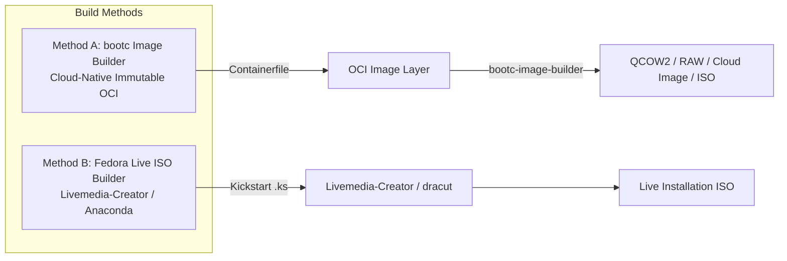

# NEXUS OS — Distribution Build Guide (`build_guide.md`)

> **Release Version**: 2026.1 (Aether Edition)  
> **Base Platform**: Fedora Linux 41 x86_64  
> **Image Formats**: Hybrid ISO9660 (`.iso`), Cloud-Native Container (`bootc`), QEMU Disk Image (`.qcow2`)  
> **Reproducibility Guarantee**: Containerized OCI layering + Versioned Kickstart  

---

## 1. Build Architecture & Methods Evaluation

NEXUS OS supports two primary official Fedora build methods:



### Method A: Cloud-Native `bootc` Pipeline (Recommended for Atomic Deployments)
- **Base Image**: `quay.io/fedora/fedora-bootc:41`
- **Definition File**: `packaging/bootc/Containerfile`
- **Tool**: `bootc-image-builder` (Red Hat / Fedora official containerized builder)
- **Advantages**: Transactional updates (`bootc update`), instant atomic rollback (`bootc rollback`), zero host configuration drift.

To build the bootc container image:
```bash
# 1. Build OCI container image
podman build -t nexus-os:2026.1 -f packaging/bootc/Containerfile .

# 2. Convert OCI image to bootable ISO / QCOW2 via bootc-image-builder
podman run \
  --rm \
  --privileged \
  -v /var/lib/containers/storage:/var/lib/containers/storage \
  -v $(pwd)/build:/output \
  quay.io/centos-bootc/bootc-image-builder:latest \
  --type iso \
  nexus-os:2026.1
```

### Method B: Native Fedora Live ISO Pipeline (`tools/build_iso.py`)
- **Definition File**: `packaging/kickstart/nexus-live-workstation.ks`
- **Advantages**: Standalone, reproducible build without requiring privileged nested container mounts.
- **Output**: Hybrid ISO9660 image (`build/nexus-os-2026.1-x86_64.iso`) with El Torito BIOS & UEFI dual-boot loaders.

To build locally:
```bash
python tools/build_iso.py
```

---

## 2. ISO Artifact Verification

Every built ISO artifact includes cryptographic checksums and volume verification:
```bash
# Check SHA256 integrity
sha256sum -c build/nexus-os-2026.1-x86_64.iso.sha256

# Verify ISO volume descriptor and El Torito boot catalog
python tools/vm_test_harness.py
```

---

## 3. Flash to USB Media

To write the generated ISO to physical USB installation media:

### On Linux / Fedora:
```bash
# Identify USB drive (e.g. /dev/sdX)
lsblk

# Flash using direct dd (hybrid ISO9660)
sudo dd if=build/nexus-os-2026.1-x86_64.iso of=/dev/sdX bs=4M status=progress conv=fsync
```

### On Windows:
Use **Rufus** (in "DD Image" mode) or **BalenaEtcher** to write `nexus-os-2026.1-x86_64.iso` to the target USB drive.
