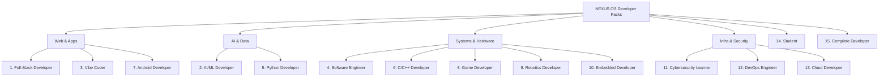

# NEXUS OS — Developer Packs Subsystem (`nexus-devpacks`)

> **Subsystem**: Developer Environment Suite & Pack Orchestrator  
> **Interface**: PyQt6 + QML (Aether Design System)  
> **State Persistence**: `~/.config/nexus/devpacks/installed_packs.json`  
> **Session Logs**: `~/.config/nexus/devpacks/logs/`  
> **Resolution**: Deduplicated Multi-Pack Graph Resolution & Topological Ordering  

---

## 1. Overview & Vision

**NEXUS OS Developer Packs** enable developers to configure and deploy a complete, verified, and cohesive development environment in a single selection immediately after OS installation or at any time thereafter.

Rather than manually researching, installing, configuring, and debugging dozens of programming languages, build systems, SDKs, and IDEs, developers can select one or more curated **Developer Packs**. The subsystem automatically:
1. **Resolves All Dependencies**: Detects and includes prerequisite compilers, runtimes, and libraries.
2. **Deduplicates Across Multiple Packs**: If a user selects both **Vibe Coder** and **Full-Stack Developer**, shared tools (`git`, `python`, `mise`, `podman`, `nodejs`) are installed only once.
3. **Calculates Accurate Storage Headroom**: Computes exact download and disk usage and verifies against available filesystem storage with a 2GB safety buffer.
4. **Validates Hardware Compatibility**: Evaluates available system RAM and GPU capabilities, providing informative guidance for resource-intensive packs (AI/ML, Robotics, Game Development).
5. **Ensures Reliability with Rollback**: Provides real-time progress callbacks, live log persistence, one-click cancellation, verification of binaries, and automated rollback if a required step fails.

---

## 2. The 15 Developer Packs Catalog



### Complete Pack Specifications

| # | Pack Name | Icon | Core Runtimes & Languages | Editors & IDEs | Key Frameworks & Utilities | Storage | Recommended Hardware |
|---|---|---|---|---|---|---|---|
| 1 | **Full-Stack Developer** | 🌐 | Node.js 22, Python 3.13, TypeScript, SQL | VS Code, Cursor | React, Next.js, Express, PostgreSQL, Podman, DBeaver, Bruno | ~3.2 GB | 8–16 GB RAM |
| 2 | **AI/ML Developer** | 🧠 | Python 3.13, CUDA C++ | Cursor, VS Code | PyTorch, Hugging Face, JupyterLab, Ollama, Scikit-Learn | ~5.4 GB | 16–32 GB RAM, NVIDIA GPU (>=6GB VRAM) |
| 3 | **Vibe Coder** | ✨ | TypeScript, Python 3.13, Markdown | Antigravity, Cursor, Windsurf | Next.js, FastAPI, Ollama, OmniRoute, Chromium DevTools, Podman | ~3.9 GB | 8–16 GB RAM, GPU recommended |
| 4 | **Software Engineer** | 💻 | C++20, Rust, Go, Python, Java 21 | VS Code, Neovim | Tokio, Spring Boot, GCC/Clang, CMake, GDB, Valgrind, Podman | ~4.1 GB | 8–16 GB RAM, Multi-core CPU |
| 5 | **Python Developer** | 🐍 | Python 3.13, SQL | VS Code, Cursor | FastAPI, Flask, Django, JupyterLab, SQLite, Bruno | ~1.9 GB | 4–8 GB RAM |
| 6 | **C/C++ Developer** | ⚙️ | C17, C++20, C++23, Assembly | VS Code, Neovim, Zed | STL, Boost, Qt6, GCC, Clang, CMake, Ninja, GDB, Valgrind | ~2.1 GB | 8–16 GB RAM |
| 7 | **Android Developer** | 📱 | Kotlin, Java 21, C++ (NDK) | Android Studio, VS Code | Jetpack Compose, Android SDK, Gradle, ADB/Fastboot, Coroutines | ~4.8 GB | 16–32 GB RAM (for Studio + AVD) |
| 8 | **Game Developer** | 🎮 | GDScript, C++20, Python 3.13 | Godot Engine 4, VS Code | Godot 4, Blender 3D, Vulkan SDK, SDL2, Krita | ~3.1 GB | 8–16 GB RAM, Vulkan 1.2+ GPU |
| 9 | **Robotics Developer** | 🦾 | C++20, Python 3.13 | VS Code | ROS 2 Jazzy, Gazebo Sim, RViz2, OpenCV, Arduino, PlatformIO | ~7.2 GB | 16–32 GB RAM, Dedicated 3D GPU |
| 10 | **Embedded Developer** | 📟 | C11, C++17, Assembly | Arduino IDE 2, VS Code | FreeRTOS, CMSIS, ESP-IDF, ARM GCC (`arm-none-eabi`), PlatformIO, OpenOCD | ~2.6 GB | 4–8 GB RAM, USB UART ports |
| 11 | **Cybersecurity Learner** | 🛡️ | Python 3.13, C, Assembly, Bash | Ghidra, VS Code | Wireshark, Nmap, Ghidra SRE, Metasploit, GDB, Scapy | ~3.4 GB | 8–16 GB RAM |
| 12 | **DevOps Engineer** | 🔄 | Go, Python 3.13, HCL, Bash | VS Code, Neovim | Podman, Kubectl, Helm, Terraform/OpenTofu, Ansible, GitHub CLI | ~2.3 GB | 8–16 GB RAM |
| 13 | **Cloud Developer** | ☁️ | Go, Python 3.13, TypeScript | VS Code, Cursor | AWS CLI, Google Cloud SDK, OpenTofu, Podman, Serverless | ~2.7 GB | 8–16 GB RAM |
| 14 | **Student** | 🎓 | Python 3.13, C++, Java 21, SQL | VS Code | Pytest, JUnit, SQLite, JupyterLab, Git, GCC, OpenJDK | ~2.8 GB | 4–8 GB RAM |
| 15 | **Complete Developer** | 👑 | Polyglot (Python, Rust, Go, C++, TS, Java) | Antigravity, Cursor, VS Code | All primary frameworks, Ollama, OmniRoute, Podman, PostgreSQL, Godot | ~9.8 GB | 16–32 GB RAM, GPU recommended |

---

## 3. Dependency Resolution & Topological Ordering

The `DevPackResolver` processes arbitrary combinations of selected packs and maps them into an optimal sequential execution plan:

1. **Deduplication**: Gathers all tool IDs across selected packs into a mathematical set, ensuring zero duplicate operations.
2. **Transitive Expansion**: Traverses the dependency graph of each tool (e.g. `android_studio` requires `openjdk`, `pytorch` requires `python`, `claude_code` requires `nodejs`, `gh` requires `git`).
3. **Tiered Topological Sort**: Sequences installation tasks according to system dependency hierarchy:
   - **Tier 1 (Priority 1–9)**: Core runtimes & utilities (`curl`, `git`, `gh`, `mise`, `podman`)
   - **Tier 2 (Priority 10–19)**: Compilers, SDKs & base languages (`gcc`, `clang`, `python`, `nodejs`, `rust`, `go`, `openjdk`, `kotlin`)
   - **Tier 3 (Priority 20–29)**: Build tools, libraries & databases (`cmake`, `gdb`, `opencv`, `pytorch`, `sqlite`, `postgresql`)
   - **Tier 4 (Priority 30–39)**: Development CLIs & test utilities (`bruno`, `dbeaver`, `kubectl`, `terraform`, `wireshark`)
   - **Tier 5 (Priority 40–59)**: Simulators, game engines & containers (`ros2`, `gazebo`, `rviz`, `godot`, `blender`, `ghidra`)
   - **Tier 6 (Priority 60–69)**: Heavy IDEs and Editors (`vscode`, `cursor`, `antigravity`, `android_studio`)
   - **Tier 7 (Priority 70+)**: Local AI daemons & services (`ollama`, `omniroute`, `jupyter`)

---

## 4. Execution Engine, Logging & Automated Rollback

The `DevPackEngine` coordinates asynchronous background execution:
- **Non-blocking Progress**: Emits percentage completion, current step, and active package name to the UI thread.
- **Timestamped File Logging**: Every session writes to `~/.config/nexus/devpacks/logs/install_<timestamp>.log`.
- **Cancellation**: Safe interruption at step boundaries.
- **Verification**: Verifies executable binaries on system PATH or container runtime presence after each step.
- **Automated Rollback**: If a required installation step fails, previously completed tasks from the active transaction are safely undone in reverse order.
- **State Persistence**: Records active installations in `~/.config/nexus/devpacks/installed_packs.json`.

---

## 5. Verification & Testing

The Developer Packs subsystem is tested in `tests/test_devpacks.py`:
- All 15 packs completeness and schema integrity.
- Detailed contents of Vibe Coder, Robotics, and AI/ML packs.
- Multi-pack deduplication and storage calculations.
- Transitive dependency resolution and topological order enforcement.
- Hardware compatibility warnings.
- Cancellation and log persistence.
- State persistence and uninstallation.
- QML view compilation and reactive bridge binding.

To run the interactive standalone launcher:
```bash
python tools/run_devpacks.py
```
