# NEXUS OS — System Settings Subsystem (`nexus-settings`)

> **Subsystem**: Settings & System Configuration  
> **Interface**: PyQt6 + QML (Aether Design System)  
> **Persistence**: `~/.config/nexus/settings.json`  
> **Security Policy**: Zero Telemetry Enforced, Polkit Privilege Separation  

---

## 1. Overview & Architectural Vision

The **NEXUS OS Settings Application** (`nexus-settings`) is the centralized configuration hub for NEXUS OS. Designed from the ground up to follow the **Aether Design System**, it combines the aesthetic refinement of modern desktop platforms with deep Linux systems control.

Unlike conventional Linux control centers that fragment settings across disparate dialogs or mock settings that do not persist, NEXUS OS Settings provides:
- **21 Distinct Categories** structured logically across 7 high-level groups.
- **Atomic Disk Persistence** via `~/.config/nexus/settings.json`.
- **Live Search Filtering** across category titles, keywords, and individual setting keys.
- **Interactive Keyboard Shortcut Editor** with conflict detection against reserved Linux and window-manager hotkeys.
- **Real Storage Analysis** providing live disk capacity and visual categorization (System, User Home, Developer Projects, AI Models Cache, Containers).
- **Code & File Indexing Exclusions** directly integrated with Spotlight (`nexus-searchd`).
- **AI Core & Local Model Daemon Integration** (`nexus-aid`, `omniroute`, `ollama`) with VRAM compositor headroom guarantees.
- **Hardware & System Inspection** reporting kernel, architecture, CPU, RAM, and detected GPU acceleration.

---

## 2. Category Organization (21 Categories across 7 Groups)

```mermaid
graph TD
    Settings[NEXUS OS Settings Hub] --> G1[Personalization]
    Settings --> G2[Hardware & Input]
    Settings --> G3[Connectivity]
    Settings --> G4[System & Search]
    Settings --> G5[Apps & Development]
    Settings --> G6[AI & Intelligence]
    Settings --> G7[Security & Maintenance]

    G1 --> C1[1. Appearance]
    G1 --> C2[2. Desktop]
    G1 --> C3[3. Dock]

    G2 --> C4[4. Keyboard & Shortcuts]
    G2 --> C5[5. Display]
    G2 --> C6[6. Sound]

    G3 --> C7[7. Network]
    G3 --> C8[8. Bluetooth]

    G4 --> C9[9. Spotlight]
    G4 --> C10[10. Indexing]
    G4 --> C11[11. Notifications]
    G4 --> C12[12. Storage]

    G5 --> C13[13. Applications]
    G5 --> C14[14. Developer Environment]

    G6 --> C15[15. AI Core]
    G6 --> C16[16. Models]

    G7 --> C17[17. System Services]
    G7 --> C18[18. Security]
    G7 --> C19[19. Privacy]
    G7 --> C20[20. Updates]
    G7 --> C21[21. About NEXUS OS]
```



### 2.1. Complete Categories Catalog

| # | Category ID | Name | Icon | Group | Description & Core Integrations |
|---|---|---|---|---|---|
| 1 | `appearance` | Appearance | 🎨 | Personalization | 10 themes (Midnight, Nord, Tokyo Night, etc.), Light/Dark mode, corner radii, compositor blur. |
| 2 | `desktop` | Desktop | 🖥️ | Personalization | Wallpapers (Nebula, Aurora, Cyberpunk, Obsidian), blur intensity, virtual workspace controls. |
| 3 | `dock` | Dock | ⚓ | Personalization | Floating dock position (bottom, left, right), size scales, auto-dodge maximized windows. |
| 4 | `keyboard` | Keyboard & Shortcuts | ⌨️ | Hardware | Keymap configuration, interactive shortcut editor, conflict detection against reserved keys. |
| 5 | `display` | Display | 📺 | Hardware | Wayland display resolution, refresh rate detection (165Hz eDP-1), UI scale factors (100%-200%). |
| 6 | `sound` | Sound | 🔊 | Hardware | PipeWire low-latency server control, master volume, input devices, alert sounds. |
| 7 | `network` | Network | 📶 | Connectivity | Wi-Fi adapter status, IP allocation, Ethernet link, loopback 127.0.0.1 protection. |
| 8 | `bluetooth` | Bluetooth | ᛒ | Connectivity | Bluetooth 5.3 adapter control, paired peripheral management (keyboards, headphones). |
| 9 | `spotlight` | Spotlight | 🔍 | System | Search result limits, search provider toggles (apps, files, symbols, commands, web). |
| 10 | `indexing` | Indexing | 🗂️ | System | SQLite FTS5 index exclusions list (`~/.ssh`, `node_modules`, `target`, `.git`), rebuild index. |
| 11 | `notifications` | Notifications | 🔔 | System | Do Not Disturb (DND) toggle, banner timeout duration, app notification rules. |
| 12 | `storage` | Storage | 💾 | System | Live drive capacity, visual storage bar, breakdown across System, Home, Dev, AI Models, Containers. |
| 13 | `applications` | Applications | 📦 | Development | Default app handlers (Browser, Editor, Terminal, File Manager), installed app management. |
| 14 | `developer` | Developer Environment | 🛠️ | Development | Default IDE (Cursor, VS Code, Zed), shell (zsh, bash), Podman container engine, mise versioning. |
| 15 | `aicore` | AI Core | ⚡ | AI | `nexus-aid` proxy port (:11430), OmniRoute (:20128), Ollama (:11434), boot autostart toggles. |
| 16 | `models` | Models | 🧠 | AI | VRAM safety headroom (2048 MB reserved for Wayland compositor), idle model unload timeout. |
| 17 | `services` | System Services | ⚙️ | System | Real-time health monitoring of `nexus-aid`, `nexus-searchd`, `omniroute`, and `ollama`. |
| 18 | `security` | Security | 🛡️ | Security | Polkit rootless desktop enforcement, local loopback API firewall rules, sandbox policies. |
| 19 | `privacy` | Privacy | 🔒 | Security | Strict zero-telemetry lock (disabled by constitution), AES-256-GCM credential vault status. |
| 20 | `updates` | Updates | 🔄 | System | System release channel (Stable, Dev Preview), DNF update check integration. |
| 21 | `about` | About NEXUS OS | ℹ️ | System | Hardware specs, CPU cores, RAM, GPU detection, kernel version, Fedora base, and licenses. |

---

## 3. Keyboard Shortcut Editor & Conflict Detection

To prevent accidental key hijacking and desktop freezes, `SettingsEngine` provides **strict conflict validation** against reserved Linux virtual console keys and window manager operations:

- **Reserved Shortcuts**:
  - `Ctrl+Alt+Del` (System Reboot / Session dialog)
  - `Meta+Tab` / `Alt+Tab` (Window and task switchers)
  - `Alt+F4` (Window termination)
  - `Ctrl+Alt+F1` through `Ctrl+Alt+F7` (Linux Virtual Terminals)
- **Automatic Normalization**: Keys are canonicalized to standard modifier order: `Ctrl` → `Meta` → `Alt` → `Shift` → `Key`.
- **Duplicate Prevention**: If a key combination is already bound to another registered action (e.g. `Meta+Space` for Universal Spotlight), the editor informs the user and prevents collisions.

---

## 4. Security & Privacy Invariants

### 4.1. Strict Zero-Telemetry Policy
NEXUS OS enforces a **strict zero-telemetry invariant**:
```python
# Enforce strict security & privacy invariants:
# Zero-telemetry policy: privacy.telemetry_enabled is always False
self._settings["privacy.telemetry_enabled"] = False
```
Any programmatic or UI request attempting to set `privacy.telemetry_enabled = True` is rejected. No telemetry probes, diagnostic pingers, or background telemetry services exist within the operating system.

### 4.2. Localhost Isolation
All AI Core daemon endpoints (`:11430`, `:20128`, `:11434`) strictly refuse WAN binding and operate exclusively over loopback (`127.0.0.1`), validated against anti-CSRF authorization tokens.

---

## 5. Verification & Testing

The settings subsystem is validated by automated test suites in `tests/test_settings_app.py`:
1. **Catalog Completeness**: Validates all 21 categories and 7 groups.
2. **Settings Persistence**: Validates reading, updating, and saving `settings.json`.
3. **Zero Telemetry**: Confirms attempts to enable telemetry are rejected.
4. **Settings Search**: Verifies matching across category titles, keywords, and setting keys.
5. **Shortcut Normalization & Conflicts**: Validates reserved and duplicate hotkey prevention.
6. **Storage Analysis**: Validates live byte capacity and 5-category storage breakdown.
7. **Indexing Exclusions**: Validates adding and removing directory patterns.
8. **System Services**: Confirms daemon health checks and autostart configuration.
9. **Hardware Specs**: Verifies host CPU, RAM, and GPU queries.
10. **QML Compilation**: Compiles `NexusSettingsView.qml` with Qt Quick without errors.

To run the standalone runner:
```bash
python tools/run_settings.py
```
