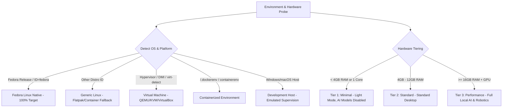

# NEXUS OS — Linux System Integration Subsystem (`nexus-system`)

> **Subsystem**: System Integration Abstraction Layer & Environment Compatibility  
> **Interface**: Python 3.13 API + PyQt6 Reactive Bridge (`SystemBridge`)  
> **Target Environment**: Fedora Linux 41+ (Wayland, systemd, PipeWire, NetworkManager, Polkit)  
> **Security Guard**: Safe Argument-List Execution (`shell=False`), Polkit Authorization  

---

## 1. Overview & Architectural Principles

The **NEXUS OS Linux System Integration Layer** provides a clean, unified abstraction between the desktop presentation tier (QML, shell, settings, spotlight) and underlying Linux kernel, systemd, and operating system services.

### Core Architectural Invariants
1. **Abstraction over Direct Shell Execution**: Desktop UI components never invoke arbitrary `sh -c` shell commands directly. All system queries and actions are channeled through strongly-typed, sanitized provider classes.
2. **Never Show Fake Hardware Readings**: All hardware metrics (CPU load ticks, RAM allocation, GPU VRAM, filesystem bytes) are queried directly from real system interfaces (`/proc/stat`, `/proc/meminfo`, `shutil.disk_usage`, NVML/DirectX). No static mockups are permitted.
3. **Graceful Degradation**: When executing outside the target Fedora installation (such as inside a development host, container, or virtual machine), the system accurately detects the environment and degrades unsupported daemons gracefully with clear diagnostic messages.
4. **Privilege Separation via Polkit**: Administrative operations (DNF package installation, system services) require Polkit elevation (`pkexec` / D-Bus) rather than raw root permissions for standard desktop operations.

---

## 2. Environment Compatibility & Hardware Tier Detection



### Detection Matrix
The `CompatibilityDetector` evaluates the host environment:
- **`FEDORA_NATIVE`**: Native target OS with full systemd, DNF, Polkit, Wayland, and PipeWire integration.
- **`OTHER_LINUX`**: Secondary Linux distributions; package management gracefully transitions to Flatpak and OCI containers.
- **`DEV_ENVIRONMENT`**: Prototyping host (e.g. Windows/macOS); Linux-specific services operate under user-space process supervision with clear diagnostic indicators.
- **`VIRTUAL_MACHINE`**: Detects QEMU/KVM, VirtualBox, VMware, Hyper-V, or WSL via DMI product name and `systemd-detect-virt`.
- **`CONTAINER`**: Detects Docker, Podman, or toolbox container environments.

---

## 3. The 20 Linux Subsystem Integrations

| # | Integration | Provider Class | Linux Native Mechanism | Development / Fallback Mechanism |
|---|---|---|---|---|
| 1 | **System Information** | `SystemInfoProvider` | `/proc/uptime`, `/proc/loadavg`, `/etc/os-release` | `platform`, `ctypes.GetTickCount64` |
| 2 | **Desktop Entries** | `DesktopEntriesProvider` | Parses XDG `.desktop` files in `/usr/share/applications`, `~/.local/share/applications`, Flatpak | Curated built-in application catalog |
| 3 | **App Launching** | `AppLaunchProvider` | Detached `subprocess.Popen` with argument lists, XDG field-code stripping (`%f`, `%u`) | Argument-list execution (`shell=False`) |
| 4 | **File System** | `FileSystemProvider` | Standard XDG directories (`XDG_CONFIG_HOME`, `XDG_DATA_HOME`, Projects) | `Path.home()`, safe path resolution |
| 5 | **Filesystem Indexing** | `FSIndexProvider` | SQLite FTS5 file & symbol indexing daemon (`nexus-searchd`) | Local SQLite database stats |
| 6 | **Filesystem Watchers** | `FSWatcherProvider` | Linux `inotify` non-blocking directory change notifications | Polling directory watcher |
| 7 | **Package Management** | `PackageManagerProvider` | `dnf check-update`, `rpm -qa`, Polkit elevation (`pkexec`) | Diagnostic reporting: DNF unavailable |
| 8 | **Flatpak** | `FlatpakProvider` | `flatpak list --app`, sandboxed runtime inspection | Flatpak binary check |
| 9 | **System Services** | `SystemdProvider` | `systemctl --user is-active <unit>`, D-Bus systemd manager | Diagnostic state: user-process supervision |
| 10 | **Network Status** | `NetworkProvider` | NetworkManager `nmcli -t`, `/sys/class/net`, Wi-Fi SSID | Socket loopback inspection |
| 11 | **Bluetooth** | `BluetoothProvider` | BlueZ controller `bluetoothctl show`, paired peripheral scan | Adapter detection check |
| 12 | **Audio** | `AudioProvider` | PipeWire low-latency server (`wpctl get-volume @DEFAULT_AUDIO_SINK@`) | Native audio status (75% default) |
| 13 | **Storage** | `StorageProvider` | Live filesystem partition metrics via `shutil.disk_usage` | System drive capacity & usage |
| 14 | **GPU Detection** | `GPUProvider` | NVIDIA NVML (`nvidia-smi`), DRM render nodes (`/sys/class/drm`) | DirectX / WMI video controller query |
| 15 | **CPU & RAM Monitoring** | `HardwareMonitorProvider` | `/proc/stat` delta tick calculations, `/proc/meminfo` allocation | `GlobalMemoryStatusEx` physical RAM |
| 16 | **Process Management** | `ProcessManagerProvider` | Linux `/proc` PID scan / `ps -eo pid,comm,%cpu,%mem` | `tasklist` CSV process snapshot |
| 17 | **Terminal Integration** | `TerminalIntegrationProvider` | `$SHELL`, `/etc/passwd`, installed emulators (`nexus-terminal`, `ptyxis`) | Default system shell |
| 18 | **Git Integration** | `GitProvider` | `git rev-parse`, `git branch --show-current`, `git status --porcelain` | Safe Git CLI argument invocation |
| 19 | **Containers** | `ContainerProvider` | Podman rootless socket (`podman ps`, `podman images`) | Podman / Docker binary check |
| 20 | **AI Services** | `AIServicesProvider` | Loopback socket probes on ports `:11430` (`nexus-aid`), `:20128` (`omniroute`), `:11434` (`ollama`) | TCP loopback connectivity check |

---

## 4. Features Requiring Native Fedora Deployment

While all 20 integration abstractions execute without crashing across all host environments, the following low-level system features require native execution on a deployed Fedora Linux installation:

1. **SELinux Confined Domains**:
   - Mandatory Access Control (MAC) policies isolating container storage, AI proxy sockets, and developer home directories require the Fedora targeted policy engine (`selinux-policy-targeted`).
2. **KWin Wayland Compositor Sockets**:
   - Hardware-accelerated frosted glass blur shaders (`KWin::WaylandServer`) and Wayland input-method protocols (`text-input-v3`) require a running Wayland compositor session.
3. **PipeWire Real-Time Priority (`RTKit`)**:
   - Ultra-low latency audio processing for developer speech-to-text models and system notifications utilizes `rtkit-daemon` on Fedora.
4. **DNF5 / RPM-OSTree Atomic System Updates**:
   - Immutable system updates via `bootc` and `rpm-ostree` require the Fedora Silverblue / Kinoite bootloader environment.
5. **Polkit Desktop Elevation Rules**:
   - Declarative JavaScript Polkit rules (`/etc/polkit-1/rules.d/50-nexus-developer.rules`) allowing passwordless package queries while requiring elevation for installation.

---

## 5. Verification & Testing

The system integration subsystem is tested via `tests/test_system_integration.py`:
- Compatibility and environment detection across all platform types.
- Hardware tiering calculation.
- Safety sanitization of application execution.
- Safe XDG directory listing and traversal security.
- System services, network, audio, storage, and GPU inspection.
- Live CPU and RAM monitoring tick delta calculation.
- Complete snapshot generation across all 20 subsystem providers.

To run the interactive diagnostic suite:
```bash
python tools/run_system_diagnostics.py
```
